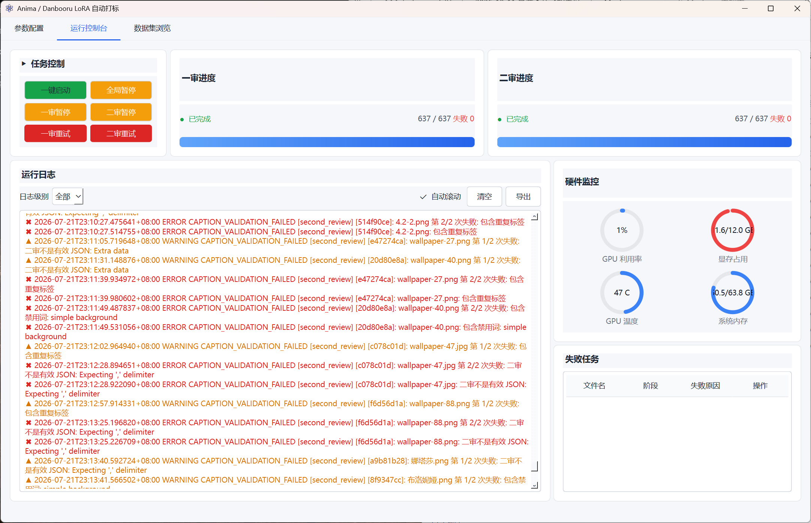

# Anima Tagger

Windows 11 桌面端的 Anima / Danbooru LoRA 双阶段自动打标工具：本地 Gemma4 多模态一审，OpenAI 兼容云端 API 二审，人工审核后导出训练 caption。

> **生产环境使用的审核提示词资产未随本仓库分发。**
> `src/anima_tagger/prompts/` 下的四份审核提示词（角色 / 画风 × 一审 / 二审）在本仓库中只保留**结构骨架**，
> 说明调用链与字段契约，不含生产提示词内容。替换这四个文件的内容即可接入自有的审核提示词，无需改动任何代码。
> 禁用词表（`src/anima_tagger/resources/forbidden_*.txt`）按资产原样保留。

---

## 界面预览



主界面分四块：

| 区域 | 内容 |
|---|---|
| **任务控制** | 开始 / 全部暂停，以及一审、二审各自的暂停 / 重试（**两个阶段独立控制**） |
| **一审 / 二审进度** | 各自的完成条与「已完成 N / N，失败 N」计数 |
| **运行日志** | 逐条带时间戳与阶段标记（`first_review` / `second_review`），可按级别筛选，支持导出 |
| **硬件监控** | GPU 利用率 / 显存、GPU 温度、系统内存（1 秒刷新，见 `HardwareMonitor`） |

右下角的**失败任务**面板按「文件名 / 阶段 / 失败原因 / 操作」列出被校验拦下的条目——
上图里能看到各类真实失败原因：包含重复标签、二审不是有效 JSON（`Extra data`、`Expecting ':' delimiter`）、
包含禁止词。这些是 `domain/` 层 caption 校验规则的输出，日志里同时保留原始响应以便回溯。

---

## 架构

```
UI | RunController | Stage Scheduler | Adapter | Caption Validator
   | Repository | File Store | Review/Export Service
```

```text
PyQt6 UI
  |-- 配置 / 文件夹 / 操作命令
  v
Application Service (RunController)
  |-- Scanner -------------> SQLite 元数据
  |-- Stage 1 Scheduler ---> LocalInferenceAdapter --> 图片名-1.txt
  |                                     | 成功即投递
  |-- Stage 2 Scheduler ---> CloudReviewAdapter ----> 图片名-2.txt
  |-- Review Service <------ -1/-2.txt + SQLite ----> 标签编辑器
  `-- Export Service -------------------------------> 图片名.txt

HardwareMonitor (1 秒) --> UI 状态栏
Event/Log Service -------> SQLite + 本地滚动日志
```

代码分层见 `src/anima_tagger/`：

| 目录 | 职责 |
|---|---|
| `domain/` | 领域模型、错误、caption 校验规则（无外部依赖） |
| `application/` | `RunController` 运行编排、人工复核服务 |
| `infrastructure/` | 云端二审、凭证、文件、硬件监控、本地推理、日志、仓储 |
| `prompts/` | 提示词资产与加载映射 |
| `resources/` | 禁用词表、应用图标 |
| `ui/` | PyQt6 主窗口与标签编辑器 |

设计取舍与外部行为约束见 [`Agent开发补充设计文档.md`](Agent开发补充设计文档.md)。

## 核心行为

- **两阶段流式并行**：一审写入 `图片名-1.txt` 成功后立即投递二审，不等待整批一审结束。
- **优雅暂停**：立即停止派发新任务，已开始的推理 / API 请求跑完并成功落盘后才停，不强杀。
- **并发闸门**：本地模型共享同一 GPU 实例，即使界面设置更高并发，也会安全限制为 1。
- **阶段文件永久保留**：`-1.txt` / `-2.txt` 不被导出流程覆盖或删除，导出只生成 `图片名.txt`。
- **凭证不入库**：Gemini Key 经 `keyring` 存入 Windows Credential Manager，不写 SQLite、不写日志。

## 启动

环境已具备依赖时可直接双击 `run_anima_tagger.bat`，或运行：

```powershell
conda activate py311_env
python -m pip install -e .
anima-tagger
```

界面中选择图片目录、主模型 GGUF 和 `mmproj` GGUF，填写 trigger word。MTP GGUF 路径会保存，但当前 `llama-cpp-python` 未暴露 Gemma4 MTP 草稿模型加载接口，不会错误地作为主模型加载。

Gemini Key 通过 Python `keyring` 持久化写入 Windows Credential Manager。启动时会自动回填为掩码，可用“显示 / 隐藏”切换可见性，并可复制到剪贴板；不会写入 SQLite 或日志。填写 Key、OpenAI 兼容地址（形如 `https://api.example.com/v1`，请替换为你自有的中转或官方端点，代理按需填写）后，点击“刷新模型”即可从该端点自动拉取模型并选用。默认二审模型为 `gemini-3.5-flash`；也可临时设置环境变量 `ANIMA_TAGGER_API_KEY`。

二审失败时，主界面的“运行日志”会实时显示 HTTP 状态、服务端错误摘要和第几次重试；可点击“复制日志”提交或保存诊断信息。完整日志同时写入 `%LOCALAPPDATA%\AnimaTagger\logs\anima_tagger.log`。

## 本地多模态诊断

```powershell
anima-tagger-cli test-local `
  --model "<模型目录>\Gemma4-12B-QAT-Q4_K_M.gguf" `
  --mmproj "<模型目录>\mmproj-Gemma4-12B-QAT-BF16.gguf" `
  --image "<图片目录>\image.png" --trigger anima_test
```

成功时最后打印 `MULTIMODAL_TEST_OK`。流水线会在原图旁生成 `图片名-1.txt`、`图片名-2.txt`，最终人工导出生成 `图片名.txt`；阶段文件不会被覆盖或删除。

## 预处理脚本（可选）

`预处理/` 下是数据集进入打标流水线之前的独立小工具，不参与运行时的分层架构，可按需单独使用：

| 脚本 | 用途 |
|---|---|
| `01 图像裁剪.py` | 按方向与比例批量裁边（例如裁掉截图黑边） |
| `02 分辨率缩小.py` | 把长边压到训练用尺寸 |
| `打上白底.py` | 把透明 PNG 合成到指定背景色，规避透明通道干扰 |

使用前请把脚本顶部的路径常量改成自己的目录。

## 测试

```powershell
conda activate py311_env
pytest -q
```

## 许可

[MIT](LICENSE)
